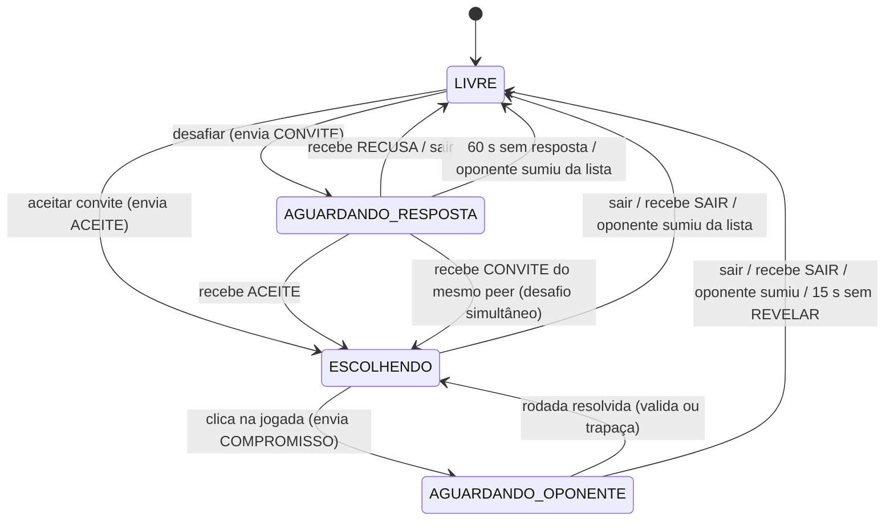
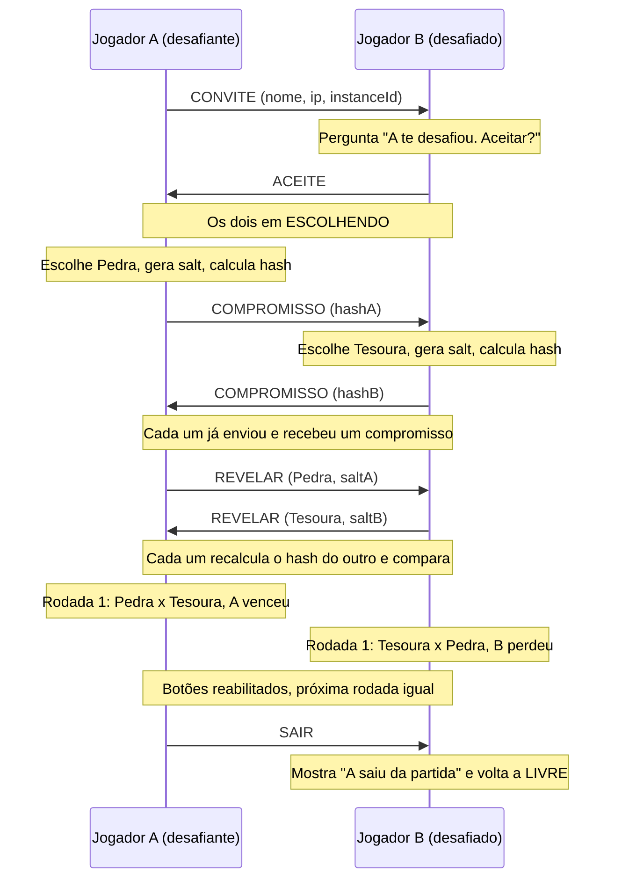

# Protocolo do plugin Pedra, Papel e Tesoura

Este documento descreve o que trafega na rede entre dois jogadores e como cada lado reage.

---

## 1. Transporte

| Item | Escolha |
| --- | --- |
| Transporte | **TCP**, via `MessageDispatcher.send(cm, msg, SendTarget.singlePeer(ip), TransportMode.TCP)` |
| Destino | Sempre um único IP (o oponente). Nunca multicast |
| Porta | A do núcleo (a mesma que a sala usa) |

**Por que TCP?** A partida é comunicação **individual 1:1** e cada passo depende do anterior (compromisso antes da revelação). O TCP entrega **sem perda e em ordem**, o que dispensa confirmações e reenvios escritos à mão. Com UDP, uma revelação perdida travaria a partida. Multicast ainda faria todo mundo da sala receber as mensagens, o que não faz sentido aqui.

**Como a mensagem chega ao plugin:** no núcleo, `SocketTCP.publicConnectionReceiver` lê os bytes e chama `PluginManager.handleMessage`, que desserializa a mensagem e chama `receiveMessage` dos plugins cujo `getMessages()` contém a classe dela (`PPTPlugin` declara `PPTMensagem`). É o mesmo caminho usado pelo chat.

---

## 2. Formato da mensagem

Os objetos `PPTMensagem` (estende `pitiupi.models.Messages.Message`) são enviados com **serialização Java** (`Message.toByteArray`). Há uma única classe; o campo `tipo` diz o significado.

| Campo | Tipo | Conteúdo |
| --- | --- | --- |
| `tipo` | enum `Tipo` | `CONVITE`, `ACEITE`, `RECUSA`, `COMPROMISSO`, `REVELAR`, `SAIR` |
| `nome` | String | Nome de quem **enviou** |
| `ip` | String | IP de quem enviou (para o outro lado poder responder) |
| `instanceId` | String | Identificador da instância de quem enviou |
| `hash` | String | SHA-256 em hexadecimal (só em `COMPROMISSO`) |
| `jogada` | String | `Pedra`, `Papel` ou `Tesoura` (só em `REVELAR`) |
| `salt` | String | Salt aleatório em hexadecimal (só em `REVELAR`) |
| `texto` | String | Motivo da recusa, opcional (só em `RECUSA`) |

O núcleo **não informa quem enviou** a mensagem, por isso nome, IP e `instanceId` vão dentro dela.

### Tipos de mensagem

| Tipo | Quem envia | Campos preenchidos | Quando |
| --- | --- | --- | --- |
| `CONVITE` | Desafiante | `nome`, `ip`, `instanceId` | Ao escolher *Desafiar...* no menu |
| `ACEITE` | Desafiado | `nome`, `ip`, `instanceId` | Ao clicar em Sim no convite |
| `RECUSA` | Desafiado | `nome`, `ip`, `instanceId`, `texto` (`ocupado` ou `recusou`) | Ao clicar em Não, ou se já estiver em partida |
| `COMPROMISSO` | Os dois | `nome`, `ip`, `instanceId`, `hash` | Quando o jogador clica em uma jogada |
| `REVELAR` | Os dois | `nome`, `ip`, `instanceId`, `jogada`, `salt` | Depois de enviar o seu compromisso **e** receber o do oponente |
| `SAIR` | Qualquer um | `nome`, `ip`, `instanceId` | Botão *Sair da partida* ou fechar a aba |

---

## 3. Compromisso e revelação (commit-reveal)

1. O jogador escolhe a jogada, por exemplo `Pedra`.
2. Gera um **salt** aleatório de 16 bytes (`SecureRandom`, em hexadecimal).
3. Calcula `hash = SHA-256(jogada + ":" + salt)`, em hexadecimal.
4. Envia **só o hash** (`COMPROMISSO`). O oponente não consegue descobrir a jogada a partir dele.
5. Só quando os **dois** compromissos foram trocados, cada um envia `REVELAR` com a jogada e o salt.
6. Quem recebe recalcula o hash e compara com o compromisso guardado.

**Por que impede trapaça?**

- *Trocar a jogada depois de ver a do outro:* o hash já foi enviado. Mudar a jogada muda o hash, e a conferência falha (*Trapaça detectada!*).
- *Adivinhar a jogada pelo hash:* só existem 3 jogadas, então sem o **salt** bastaria testar as 3. Com 16 bytes aleatórios no meio, isso deixa de ser possível.
- *Esperar o outro revelar para só então escolher:* ninguém revela antes de ter enviado o próprio compromisso, e o compromisso não pode mais ser mudado.

---

## 4. Máquina de estados

Cada jogador tem um estado:

| Estado | Significado | Botões de jogada |
| --- | --- | --- |
| `LIVRE` | Sem partida | desabilitados |
| `AGUARDANDO_RESPOSTA` | Enviou `CONVITE`, espera `ACEITE`/`RECUSA` | desabilitados |
| `ESCOLHENDO` | Em partida, escolhendo a jogada da rodada | **habilitados** |
| `AGUARDANDO_OPONENTE` | Já enviou o compromisso; espera o oponente (e depois a revelação) | desabilitados |

Dentro de uma rodada, o plugin também guarda: meu hash, minha jogada e salt, se já revelei, o hash do oponente e (quando chega) a jogada e o salt dele. A rodada é fechada quando **já revelei** e tenho **o hash e a revelação** do oponente, em qualquer ordem de chegada.

---

## 5. Sequência de uma partida completa

---

## 6. Regras de validação

| Situação | O que o plugin faz |
| --- | --- |
| `instanceId` da mensagem é o **meu** (eco) | Ignora |
| Mensagem (exceto `CONVITE`) de quem **não é o oponente atual** | Ignora |
| Qualquer mensagem enquanto estou `LIVRE` (exceto `CONVITE`) | Ignora |
| `CONVITE` de quem eu mesmo desafiei (os dois se desafiaram ao mesmo tempo) | Envia `ACEITE` e começa a partida direto |
| `CONVITE` com partida em andamento, outro convite aberto ou aguardando resposta de outra pessoa | Responde `RECUSA` com texto `ocupado` |
| `ACEITE`/`RECUSA` fora do estado `AGUARDANDO_RESPOSTA` | Ignora |
| Segundo `COMPROMISSO` ou segundo `REVELAR` na mesma rodada | Ignora (vale o primeiro) |
| `REVELAR` chega antes de eu revelar | Guarda; a rodada fecha depois que eu revelar |
| Hash recalculado diferente do compromisso, ou jogada inválida | Registra *Trapaça detectada!* no histórico, **não conta a rodada**, volta a `ESCOLHENDO` |
| `SAIR` do oponente | Mostra *X saiu da partida* e volta a `LIVRE` |

A fórmula do vencedor: Pedra vence Tesoura, Tesoura vence Papel, Papel vence Pedra; iguais empatam.

Toda atualização da tela roda na thread de eventos do Swing (`SwingUtilities.invokeLater`), porque `receiveMessage` é chamado pela thread de rede. Os envios saem por uma única thread própria, o que mantém a ordem (`COMPROMISSO` antes de `REVELAR`) e não congela a interface.

---

## 7. Tratamento de erros e limitações

### Timeouts e queda do oponente

Um `javax.swing.Timer` roda a cada 3 segundos e confere a partida:

| Situação | Tempo | O que acontece |
| --- | --- | --- |
| Oponente não aparece mais na lista de usuários do Pitiupi (`getPresenceService().listPeerViews()`) | até ~15 s (tempo do heartbeat do núcleo) | Mostra *X desconectou* e volta a `LIVRE` |
| Enviei `CONVITE` e não veio `ACEITE` nem `RECUSA` | 60 s | Mostra *X não respondeu ao desafio* e volta a `LIVRE` |
| Já enviei meu `REVELAR` e o do oponente não chegou | 15 s | Mostra *X parou de responder* e volta a `LIVRE` |

Nos três casos o plugin ainda manda um `SAIR` para o oponente, caso ele continue lá. Não existe timeout para o oponente **escolher** a jogada, porque isso depende da pessoa; nesse caso só a queda da lista encerra a partida.

O TCP já garante a entrega enquanto a conexão está de pé, então o plugin não usa ack próprio: o que ele precisa detectar é o oponente sumir, e isso os timeouts resolvem. Se `MessageDispatcher.send` retornar 0 (sem conexão), aparece *Falha ao enviar ...* no histórico.

### Outras limitações

- **Rodada anulada por trapaça.** O lado que detecta anula a rodada e segue. O trapaceiro, se existir, também recebe a revelação e resolve do próprio jeito. Não há votação nem banimento.
- **Sem autenticação.** Nome, IP e `instanceId` vêm dentro da mensagem e podem ser forjados. O protocolo protege contra troca de jogada, não contra falsificação de identidade.
- **Ordem de entrega.** Supõe-se que a revelação de uma rodada chegue antes do compromisso da seguinte, o que o TCP numa mesma conexão garante.
- **TCP para o próprio host** não é suportado pelo núcleo; teste sempre com dois computadores.
